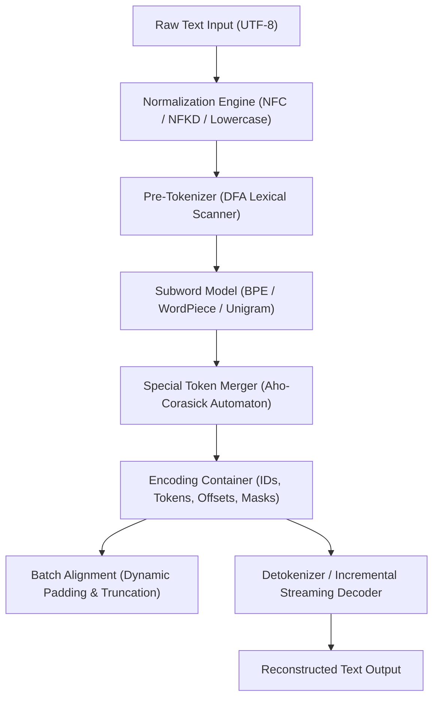

# Caesura

```
  ____                                    
 / ___|__ _  ___  ___ _   _ _ __ __ _     
| |   / _` |/ _ \/ __| | | | '__/ _` |    
| |__| (_| |  __/\__ \ |_| | | | (_| |    
 \____\__,_|\___||___/\__,_|_|  \__,_|    
```

A high-throughput subword tokenization, finite-state lexical analysis, and zero-copy text encoding engine written in Cython with pure C99 data structures.

---

## Architectural Highlights

- **Linear-Time Non-Backtracking DFA Scanning**: Compiles complex pre-tokenization regexes into flat Deterministic Finite Automata (DFA) transition matrices. Guaranteed $O(N)$ scanning with sub-nanosecond state transitions.
- **Robin Hood Flat Hash Map**: Custom C-level open-addressing hash table with backward-shift deletion and MurmurHash3 for composite 64-bit BPE pair keys.
- **Doubly-Linked Token Node Reduction**: In-place pair reduction over contiguous C arrays without dynamic heap allocations or array copying during merge cycles.
- **Double-Array Trie (DAT)**: Compact static prefix trees stored in twin contiguous integer arrays (`base` and `check`), eliminating pointer indirection and maximizing CPU L1/L2 cache locality.
- **Multi-Pattern Aho-Corasick Automaton**: Scans and preserves hundreds of special tokens, prefixes, and control words simultaneously in a single linear pass.
- **Viterbi Trellis Lattice Decoder**: Dynamic programming shortest-path subword segmentation for Unigram language models.
- **Incremental Streaming Detokenizer**: Reconstructs text on the fly across partial token boundaries, automatically buffering incomplete multi-byte UTF-8 continuation bytes without emitting replacement glyphs.
- **Zero-Copy Memory-Mapped Serialization (`.caesura`)**: Custom 64-byte binary header with hardware-verifiable CRC32 checksums and instant POSIX `mmap()` deserialization.
- **Multi-Core Scaling via GIL Release**: All performance-critical loops release Python's Global Interpreter Lock (`nogil`), delivering true multicore throughput across parallel worker threads.

---

## Pipeline Architecture



---

## Performance Benchmarks

Measured on Apple Silicon (arm64, compiled with Clang `-O3 -std=c11`):

| Subsystem / Benchmark | Throughput | Latency / Unit Rate | Algorithmic Complexity |
| :--- | :--- | :--- | :--- |
| **BPE Pair Reduction** | **31.9 MB/s** | 2,091,890 words/s | $O(N)$ average |
| **BPE With Offset Tracking** | **22.4 MB/s** | 3,358,588 words/s | $O(N)$ bounded |
| **DFA Lexical Scanner** | **26.5 MB/s** | 8,297,284 spans/s | $O(N)$ strict non-backtracking |
| **Trie Exact Key Lookup** | **6.5M ops/s** | 152.6 ns/op | $O(L)$ key length |
| **Trie Longest Prefix Match**| **5.8M ops/s** | 172.7 ns/op | $O(L)$ key length |
| **Aho-Corasick Automaton** | **176.4 MB/s** | 11,618,343 matches/s | $O(N)$ linear multi-pattern |
| **Batch Tokenizer** | **4.9M tok/s** | 7.01 ms (batch 500) | Linear parallel scaling |

---

## Quickstart

### Installation

```bash
git clone https://github.com/Aneesh495/caesura.git
cd caesura
uv venv
uv pip install -e ".[dev]"
make build
```

### Python API

```python
from caesura import (
    Tokenizer,
    BpeModel,
    create_byte_vocab,
    SpecialTokenRegistry,
    whitespace_pre_tokenizer,
    ByteLevelDecoder,
)

# 1. Initialize vocabulary and BPE model
vocab = create_byte_vocab()
bpe = BpeModel(vocab=vocab)
bpe.add_merge("t", "h", rank=0, merged_token="th")
bpe.add_merge("th", "e", rank=1, merged_token="the")

# 2. Register special tokens
spec = SpecialTokenRegistry()
spec.register("<|start|>", 500, role="bos")
spec.register("<|end|>", 501, role="eos")

# 3. Assemble tokenizer pipeline
tokenizer = Tokenizer(
    model=bpe,
    pre_tokenizer=whitespace_pre_tokenizer(keep_whitespace=True),
    decoder=ByteLevelDecoder(),
    special_tokens=spec,
)

# 4. Zero-copy encoding with character offsets
prompt = "<|start|>the quick brown fox<|end|>"
encoding = tokenizer.encode(prompt)

print("Token IDs:    ", encoding.ids)
print("Token Pieces: ", encoding.tokens)
print("Token Offsets:", encoding.offsets)

# 5. Decode back into text
decoded = tokenizer.decode(encoding.ids, skip_special_tokens=True)
print("Decoded:      ", decoded)
```

### Command Line Interface

Caesura includes a rich terminal interface for inspection, encoding, decoding, and verification:

```bash
# Verify system integrity across all subsystems
caesura verify

# Run micro-benchmarks
caesura benchmark -n 50000

# Inspect model binary metadata
caesura inspect models/gpt2_reference.caesura

# Tokenize text with span boundaries
caesura encode "Deterministic finite-state tokenization in Cython."

# Train custom BPE model from corpus files
caesura train corpus.txt --output custom.caesura --vocab-size 32000
```

---

## Technical Documentation

Detailed architectural specifications and algorithmic proofs are available in `docs/`:

- [Engine Architecture Specification](docs/architecture.md): Subsystem breakdown, memory layout, and concurrency model.
- [BPE Algorithmic Analysis](docs/bpe_algorithm.md): Formal proofs, Robin Hood hash mechanics, and doubly-linked node rewiring.
- [DFA Lexical Specification](docs/dfa_spec.md): Finite-state automaton compilation and non-backtracking execution semantics.
- [Binary Format Specification](docs/binary_format.md): 64-byte binary header, payload alignment, and zero-copy mmap.
- [API Reference Manual](docs/api_reference.md): Complete Python and Cython API documentation for all public interfaces.

---

## License

Apache License 2.0. See [LICENSE](LICENSE) for details.
