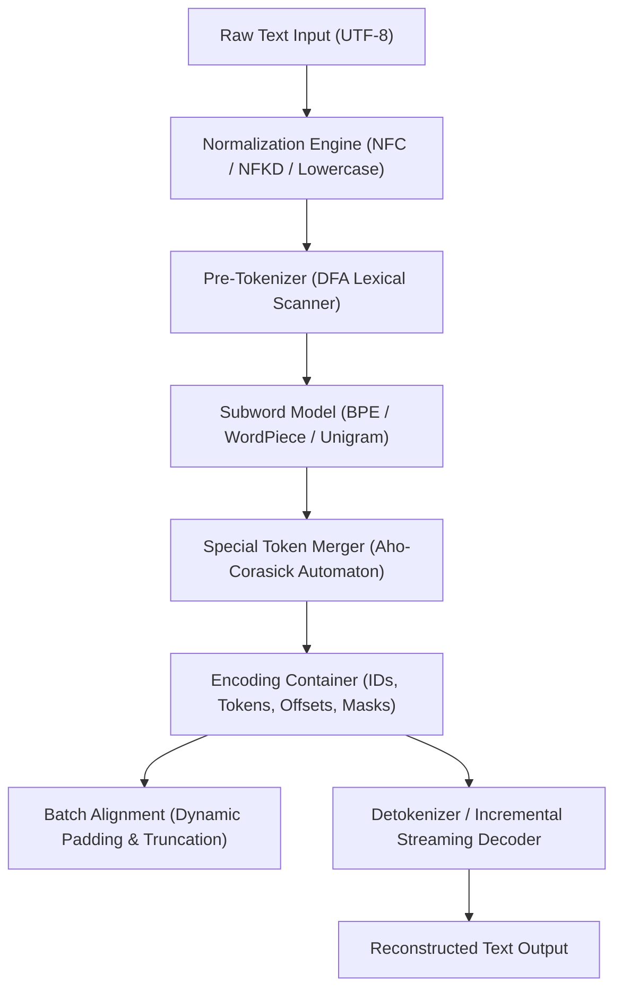

# Caesura Engine Architecture Specification

Caesura is a high-throughput subword tokenization and lexical analysis engine built with high-performance Cython and pure C99 data structures. It provides deterministic execution, memory arena allocation, zero-copy binary serialization, and Python developer ergonomics.

## System Pipeline Overview

The tokenization lifecycle consists of five discrete stages arranged in a unidirectional pipeline. Each stage is strictly decoupled, allowing custom normalizers, regex scanners, subword models, and post-processors to be composed arbitrarily.



## Subsystem Architecture

### 1. Memory Management Subsystem

Standard high-level runtimes incur significant overhead from per-token object allocations and garbage collector pauses. Caesura bypasses runtime heap allocation in hot paths through two dedicated C99 mechanisms:

1. **Bump Memory Arena (`caesura.core.memory.MemoryArena`)**: Allocates memory sequentially from pre-reserved contiguous blocks (default 64 KB). Resetting the arena costs O(1) time by rewinding a single byte offset pointer, eliminating fragmented heap deallocations.
2. **Contiguous Token Buffer (`caesura.core.buffer.TokenBuffer`)**: Token IDs, start offsets, end offsets, and attention flags are packed into contiguous C arrays. This maximizes L1/L2 data cache locality during subword iteration and batch matrix transformations.

```mermaid
flowchart LR
    subgraph MemoryArena["Memory Arena (Contiguous Block)"]
        Allocated["Allocated Chunks (Tokens, Nodes, Spans)"]
        Cursor["Offset Cursor"]
        Available["Available Space"]
    end
    Cursor -->|O(1) Bump Allocation| Available
    Cursor -.->|O(1) Rewind Reset| Allocated
```

### 2. Finite-State Lexical Scanner (`caesura.regex.dfa`)

Pre-tokenization splits unbroken text streams into lexical candidates (words, numbers, contractions, whitespace runs). Unlike traditional backtracking regular expression engines that exhibit worst-case exponential time complexity O(2^N), Caesura compiles tokenization grammars into Deterministic Finite Automata (DFA).

- **Non-Backtracking Guarantees**: Exactly one byte is consumed per state transition. Execution runtime is strictly O(N) with respect to input byte length.
- **Direct Table Transition**: State transitions are indexed via a flat 2D lookup table: `next_state = transition_table[current_state * 256 + byte_val]`.
- **Pre-Compiled Standard Grammars**: Includes optimized DFA tables for GPT-2, GPT-4, Llama-3, whitespace, and punctuation splitting.

### 3. High-Performance Trie and Double-Array Trie (`caesura.trie`)

Lexicon matching and prefix validation are powered by two complementary trie implementations:

- **Pointer-Based Trie (`caesura.trie.trie.Trie`)**: Array-backed internal trie designed for fast dynamic insertions and fuzzy Levenshtein distance searches.
- **Double-Array Trie (`caesura.trie.double_array.DoubleArrayTrie`)**: Compact static representation using twin integer arrays (`base` and `check`). It eliminates pointer indirection, storing state transitions directly in contiguous memory to prevent cache misses.
- **Aho-Corasick Automaton (`caesura.trie.aho_corasick.AhoCorasick`)**: Evaluates multiple dictionary patterns simultaneously in a single pass using failure transitions, used for special token injection and protected sequence preservation.

### 4. Subword Modeling Core (`caesura.models`)

Caesura implements the three dominant subword algorithms in natural language modeling:

| Model Architecture | Algorithmic Paradigm | Time Complexity | Primary Use Case |
| :--- | :--- | :--- | :--- |
| **Byte-Pair Encoding (BPE)** | Greedy bottom-up pair reduction | O(N log N) with Min-Heap | GPT-2, GPT-4, Llama, Mistral |
| **WordPiece** | Greedy longest-prefix matching | O(N * L) with Trie fast path | BERT, DistilBERT, Electra |
| **Unigram** | Dynamic programming Viterbi trellis | O(N * K) shortest path lattice | T5, ALBERT, SentencePiece |

### 5. Multi-Core Scaling & GIL Release

All computationally intensive loops (UTF-8 byte scanning, DFA state transitions, BPE pair reduction, and batch matrix alignment) are executed in pure C with the Python Global Interpreter Lock (GIL) explicitly released (`nogil`). 

This architecture allows Python threads to achieve linear horizontal throughput scaling across all available CPU cores without inter-process communication serialization overhead.
