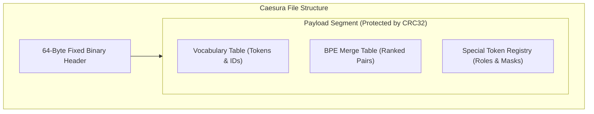

# Caesura Binary Format (.caesura) and Zero-Copy mmap Specification

## 1. Specification Overview

The `.caesura` format is an alignment-optimized binary container engineered for zero-copy memory-mapped loading (`mmap`). It replaces bloated JSON/Pickle formats with packed C-native primitives, fixed 64-byte headers, and CRC32 hardware-verifiable checksums.

## 2. 64-Byte Fixed Header Layout

Every `.caesura` file begins with a fixed 64-byte header packed in little-endian format:

| Byte Offset | Field Name | Data Type | Default Value | Description |
| :--- | :--- | :--- | :--- | :--- |
| `0x00 .. 0x07` | `magic` | `char[8]` | `CAESURA\x01` | Format identifier signature |
| `0x08 .. 0x0B` | `version` | `uint32_t` | `1` | Binary schema specification version |
| `0x0C .. 0x0F` | `endian_tag` | `uint32_t` | `0x01020304` | Endianness verification marker |
| `0x10 .. 0x13` | `model_type` | `uint32_t` | `1` | Model kind: `1`=BPE, `2`=WordPiece, `3`=Unigram |
| `0x14 .. 0x17` | `vocab_count` | `uint32_t` | `|V|` | Total vocabulary entries |
| `0x18 .. 0x1B` | `merges_count`| `uint32_t` | `|M|` | Number of BPE merge pairs (0 for WordPiece/Unigram) |
| `0x1C .. 0x1F` | `spec_count` | `uint32_t` | `|S|` | Number of registered special tokens |
| `0x20 .. 0x23` | `crc32` | `uint32_t` | Checksum | CRC32 of payload bytes (offsets `0x40` to EOF) |
| `0x24 .. 0x3F` | `reserved` | `uint8_t[28]` | Zeroes | Reserved for future format expansion |

## 3. Payload Packing Structure

The payload starts immediately at byte offset 64 (`0x40`) and consists of three consecutive sections:

### Section A: Vocabulary Table

Repeated `vocab_count` times:
- `tok_len`: `uint16_t` (2 bytes, length of UTF-8 string)
- `token_id`: `uint32_t` (4 bytes, numerical token ID)
- `token_bytes`: `uint8_t[tok_len]` (Raw UTF-8 bytes)

### Section B: Merge Rules Table (BPE Models Only)

Repeated `merges_count` times:
- `left_id`: `uint32_t` (4 bytes, left subword token ID)
- `right_id`: `uint32_t` (4 bytes, right subword token ID)
- `rank`: `uint32_t` (4 bytes, priority rank integer)
- `merged_id`: `uint32_t` (4 bytes, target merged token ID)

### Section C: Special Token Registry

Repeated `spec_count` times:
- `tok_len`: `uint16_t` (2 bytes, length of special token string)
- `spec_id`: `uint32_t` (4 bytes, special token ID)
- `role_len`: `uint16_t` (2 bytes, length of role name, e.g., 'bos', 'eos', 'pad')
- `tok_bytes`: `uint8_t[tok_len]` (UTF-8 bytes of token)
- `role_bytes`: `uint8_t[role_len]` (UTF-8 bytes of role, omitted if `role_len == 0`)

## 4. Zero-Copy Memory-Mapped Loading (`mmap`)

Rather than allocating megabytes of heap memory to deserialize JSON or text representations, Caesura memory-maps the binary file directly via the POSIX `mmap()` system call:

1. The OS maps file pages directly into the process virtual address space.
2. File pages are paged in lazily by the kernel virtual memory manager on demand.
3. Deserialization completes in sub-millisecond time, providing instant startup for multi-process inference workers and containers.
