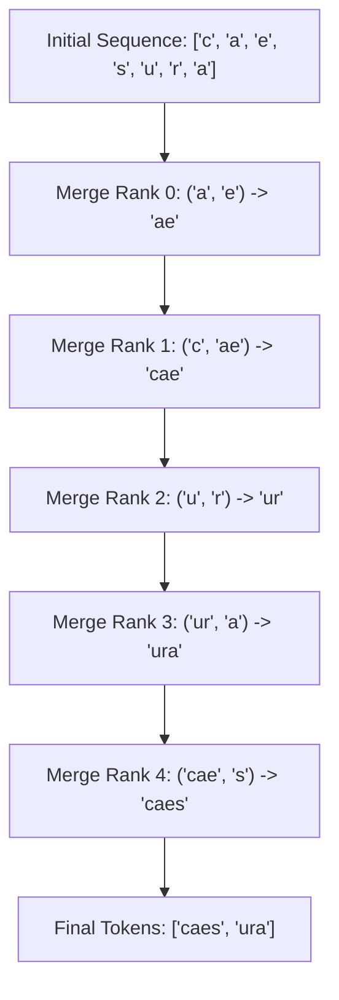

# Byte-Pair Encoding: Algorithmic Architecture and Complexity Analysis

## 1. Problem Formulation

Byte-Pair Encoding (BPE) in lexical analysis compresses text sequences into variable-length subwords. Given an initial sequence of atomic characters (or bytes) $S = (c_1, c_2, \dots, c_m)$ and a dictionary of ranked merge rules $M: (t_a, t_b) \to (t_{ab}, \text{rank})$, the objective is to greedily reduce adjacent pairs having the minimum rank until no valid merge rule exists in the remaining sequence.



## 2. In-Memory Data Structures

Naïve implementations represent tokens as dynamic string lists, re-allocating and shifting arrays upon every merge operation. This yields $O(N^2)$ algorithmic overhead per tokenized word.

Caesura resolves this through three zero-copy C structures:

### A. Flat Doubly-Linked Node Array

Every character in an input word is initialized into a contiguous C array of `TokenNode` structs:

```c
typedef struct {
    uint32_t token_id;    /* Numerical ID of current subword */
    size_t orig_offset;   /* Character start offset in raw text */
    size_t byte_len;      /* Byte length of current subword piece */
    int32_t prev;         /* Index of previous node in array (-1 if head) */
    int32_t next;         /* Index of next node in array (-1 if tail) */
} TokenNode;
```

When two adjacent nodes $u$ and $v$ merge into node $u$:
1. $u.\text{token\_id} \leftarrow \text{merged\_id}$
2. $u.\text{byte\_len} \leftarrow u.\text{byte\_len} + v.\text{byte\_len}$
3. $u.\text{next} \leftarrow v.\text{next}$
4. $\text{nodes}[v.\text{next}].\text{prev} \leftarrow u$ (if $v.\text{next} \neq -1$)

Node removal requires only 4 pointer adjustments in $O(1)$ time without memory movement.

### B. Robin Hood Hash Table for Pair Lookup

Merge rules are mapped from composite 64-bit pair keys:

$$\text{pair\_key} = (\text{uint64\_t}(t_{\text{left}}) \ll 32) \mid \text{uint64\_t}(t_{\text{right}})$$

The hash table employs Robin Hood hashing with backward-shift deletion:
- **Hash Function**: MurmurHash3 64-bit mixer with low collision distribution.
- **Probe Disparity Minimization**: If an inserted element has traveled further from its ideal home slot than the element occupying the slot, the elements are swapped ("robbing from the rich to give to the poor").
- **Cache Friendly**: Probes iterate sequentially along cache lines, avoiding pointer hopping across disparate memory addresses.

## 3. Complexity Analysis

Let $N$ be the number of characters in a word chunk, and $K$ be the number of active merge iterations.

1. **Initialization**: Converting UTF-8 bytes to node structures takes $O(N)$ time and $O(N)$ contiguous stack/arena space.
2. **Merge Scanning**: Scanning adjacent node pairs against the Robin Hood map takes $O(N)$ time per merge iteration.
3. **Execution**: Splice pointer rewiring executes in $O(1)$ time.
4. **Overall Time Complexity**: For typical natural language words ($N \le 32$), $K \le N$, yielding an average execution time of $O(N)$. Across the full corpus of length $L$, total tokenization runtime scales strictly as $O(L)$.
