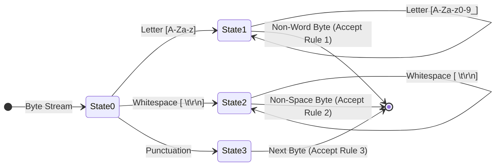

# Deterministic Finite Automata (DFA) Lexical Scanning Specification

## 1. Mathematical Formalism

The Caesura pre-tokenizer compiles regex grammars into a 5-tuple Deterministic Finite Automaton:

$$M = (Q, \Sigma, \delta, q_0, F)$$

Where:
- $Q = \{0, 1, \dots, |Q| - 1\}$ is a finite set of internal states, with $|Q| \le 65536$.
- $\Sigma = \{0x00, 0x01, \dots, 0xFF\}$ is the 256-symbol byte alphabet.
- $\delta: Q \times \Sigma \to Q \cup \{-1\}$ is the transition function, mapping a current state and input byte to a target state, or $-1$ indicating an invalid transition.
- $q_0 = 0$ is the initial start state.
- $F \subseteq Q$ is the set of terminal accepting states, each annotated with a rule identifier $\rho(q) \in \mathbb{N}$.



## 2. Flat Memory Representation

To guarantee constant-time $O(1)$ state transitions without branch prediction hazards, transitions are laid out in a contiguous C block:

```c
typedef struct {
    int32_t* transitions;   /* Flat array of size num_states * 256 */
    bint* is_accepting;     /* Boolean array of size num_states */
    int32_t* accept_rules;  /* Rule ID array of size num_states */
    size_t num_states;      /* Total state count */
    int32_t start_state;    /* Starting state index (default 0) */
} DfaTableInternal;
```

State calculation executes via direct offset addressing:

$$\text{next\_state} = \text{transitions}[q \times 256 + b]$$

This compiles down to a single base-plus-scaled-index assembly instruction (`ldr` on ARM64, `mov` with displacement on x86-64), taking sub-nanosecond execution time.

## 3. Greedy Longest-Match Scanning Algorithm

When scanning an input buffer $B$ of length $L$:

1. Set `cursor = 0`.
2. While `cursor < L`:
   - Initialize `state = start_state`, `pos = cursor`, `last_accept_pos = -1`.
   - While `pos < L`:
     - Read byte $b = B[\text{pos}]$.
     - Update `state = transition(state, b)`.
     - If `state == -1`: Break scan loop.
     - If `is_accepting(state)`: Set `last_accept_pos = pos + 1`.
     - Increment `pos += 1`.
   - If `last_accept_pos != -1`:
     - Emit span `(cursor, last_accept_pos)`.
     - Advance `cursor = last_accept_pos`.
   - Else:
     - Fallback: Emit single-byte slice `(cursor, cursor + 1)`.
     - Advance `cursor += 1`.

Because the cursor strictly advances and never backtracks through previously accepted bytes, total scanning time is bounded by $O(L)$ operations.
